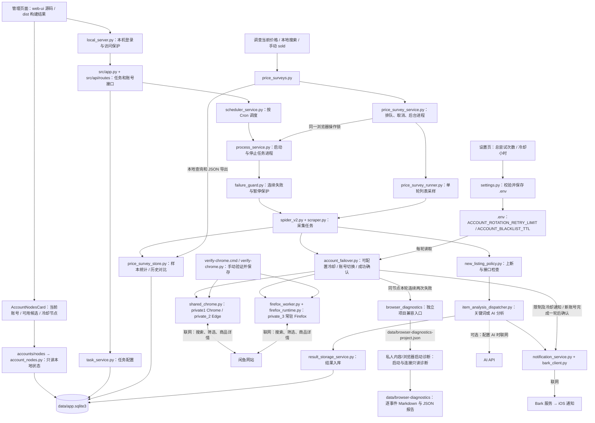
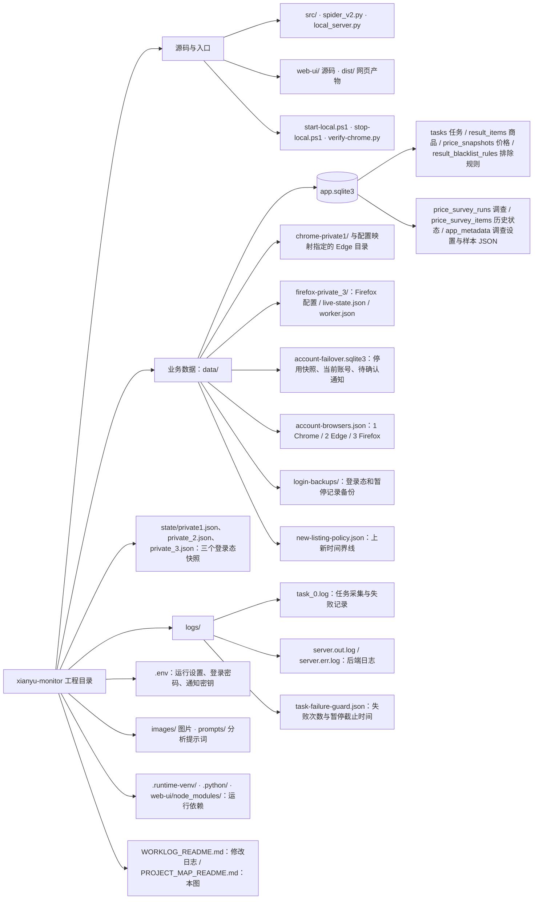

# 本地工程功能与存储图

更新：2026-11-08。根据本地源码和实际目录整理，不包含账号密码、Cookie 或推送密钥。

## 1. 功能流程

Firefox 使用 Playwright 配套运行时和独立持久配置，由本机常驻 worker 持有；任务进程通过仅监听回环地址、带随机令牌认证的接口提交工作。每轮结束保留同一个浏览器与会话，取消任务或客户端掉线会取消采集。普通日用 Firefox 不被接管。2026-11-08 实测 private_3 完成搜索、最新排序、价格筛选并解析 30 条商品；private1 初始搜索正常；private_2 当次被闲鱼要求手动验证。

## 2. 本地存储结构

## 阅读说明

- 当前主要业务存储为 `data/app.sqlite3`。界面出现的 `_full_data.jsonl` 也可能只是数据库中的结果集名称，不代表同名实体文件。
- `config.json` 为旧配置/导入兼容文件；当前任务以 SQLite 与管理接口为准。
- `state/private_2.json` 是登录态快照；`data/chrome-private_2/` 是持续使用的浏览器配置目录，二者用途不同。
- `.env`、登录态快照、Chrome 配置目录和登录态备份含敏感信息，不应公开分享。
- Firefox 的 live-state.json 保存续期后的会话，worker.json 包含本机连接令牌，同样不应公开分享。新导入的账号快照优先于旧的运行快照。
- 只对当前选定账号执行定时搜索；备用和冷却账号不轮询闲鱼。冷却到期只恢复候选资格，真正被选中时才访问闲鱼。
- 账号冷却截止保存在 account-failover.sqlite3；当前默认六小时，可在设置页修改。受限时推送冷却截止与下一账号，切换后首次成功完成采集再发确认。
- 同一轮同一账号总尝试次数当前为 2（含首次），可在设置页修改；新配置从下一轮生效，已有冷却截止不回写。常驻 Firefox 也逐轮读取同一份本地配置，不需重开浏览器。
- 2026-11-08 更新：超时、登录/验证、搜索、排序筛选等采集异常共用上述次数上限，混合类型也累计。当前账号同一轮连续两次失败即本地冷却并选择下一节点；托管轮换不再叠加旧 FailureGuard 的三次任务暂停。取消不计失败，手动价格调查仍不自动重试。
- 账号节点面板位于任务页和账号页，页面可见时每 15 秒读取一次本地状态，不增加闲鱼检查次数。
- 本地图不改变任务、筛选、通知或检查频率。
- 手动价格调查默认 100 件，网页可改为 1–500；每次只执行一轮列表翻页，使用参考任务的当前可用账号，和正常监测排队使用浏览器。已有定时规则不改变。
- “本次未出现”只是有界搜索样本中缺失，不等于已售出；sold 与成交价由用户确认填写，最后标价另存。查询和导出均为本地操作。
- LOCAL_LIST_ONLY=true 时，日常新商品从列表数据分析与 Bark 推送，不自动打开详情页；详情描述和卖家资料不会采集。
