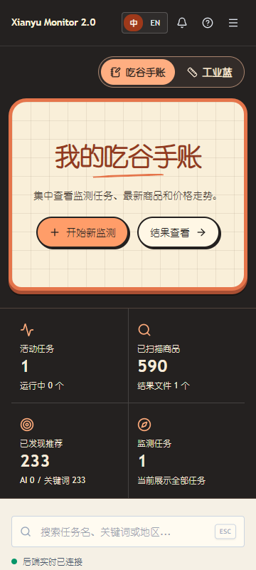
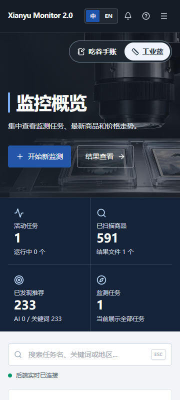
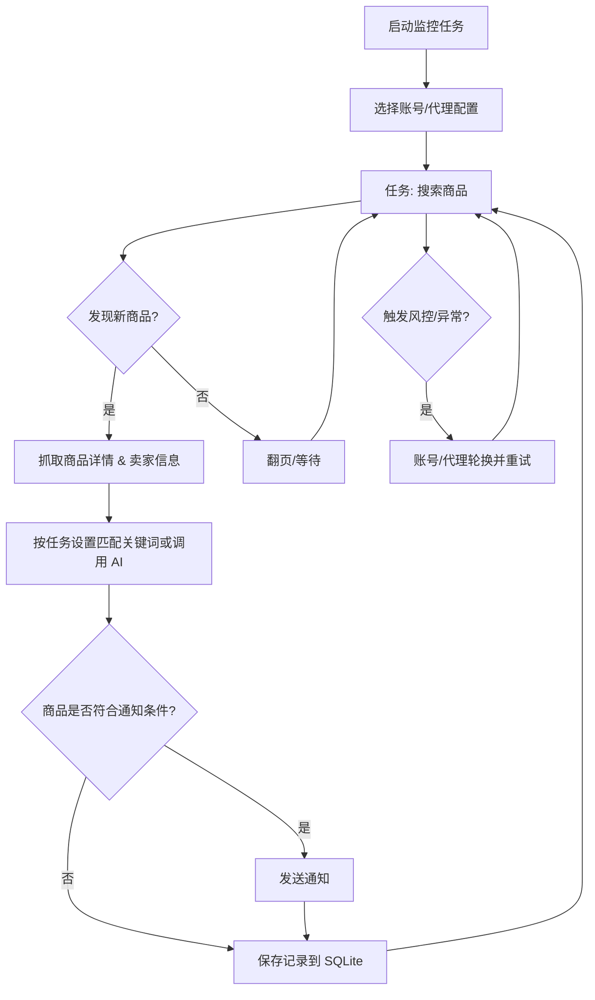

# Xianyu Monitor 2.0

[中文] ｜ [English（原版文档）](README_EN.md)

Xianyu Monitor 2.0 在原开源版本之上增加了本机浏览器节点管理、多关键词监测、历史售出核验和两套管理页主题。你可以在网页里配置任务、查看结果和排查故障，由本地后端负责定时搜索、保存结果和发送通知。[原项目 Usagi-org/ai-goofish-monitor](https://github.com/Usagi-org/ai-goofish-monitor)

- [Windows 本地使用教程](#windows-本地使用教程)
- [2.0 对原版的体验改进](#20-对原版的体验改进)
- [前后端分开维护的好处](#前后端分开维护的好处)
- [前后台拆分规划](#前后台拆分规划)

## Windows 本地使用教程

### 1. 下载并启动

准备 Git、Python 3.12、Node.js 22 LTS（22.12 或更新，含 npm）和 Chrome。在 PowerShell 中运行：

```powershell
git clone https://github.com/Twelvedgeice/XianyuMonitor2.0.git
Set-Location XianyuMonitor2.0
Copy-Item .env.example .env
py -3.12 -m venv .runtime-venv
.\.runtime-venv\Scripts\python.exe -m pip install -r requirements-runtime.txt
$env:PLAYWRIGHT_BROWSERS_PATH = Join-Path $PWD '.browsers'
.\.runtime-venv\Scripts\python.exe -m playwright install chromium
npm --prefix web-ui ci
npm --prefix web-ui run build
New-Item -ItemType Directory -Path logs -Force | Out-Null
```

打开 `.env`，设置自己的 `WEB_USERNAME` 和 `WEB_PASSWORD`。只用关键词判断时，将 `OPENAI_API_KEY` 留空即可。要使用 AI 建任务或分析商品，再填写有效的 `OPENAI_API_KEY`、`OPENAI_BASE_URL` 和支持图片输入的 `OPENAI_MODEL_NAME`。

双击 `start-local.cmd` 启动服务，打开管理页并使用刚设置的管理账号登录。停止服务时双击 `stop-local.cmd`。遇到启动问题，查看 `logs/server.err.log`。[打开本地管理页](http://127.0.0.1:8765)

### 2. 添加闲鱼登录态

任选一种方式：

- 双击 `login-local.cmd`，在弹出的 Chromium 中自行登录闲鱼。登录后回到命令窗口按 Enter，登录态会保存为 `state/personal.json`。
- 在「账号管理」中导入已有的 Playwright 登录态 JSON。使用原项目配套扩展可以导出浏览器中的登录态。[Chrome 扩展](https://chromewebstore.google.com/detail/xianyu-login-state-extrac/eidlpfjiodpigmfcahkmlenhppfklcoa)

闲鱼登录态会保存在本机 `state/`。管理页账号与闲鱼账号各有用途：前者登录本地管理页，后者授权本机浏览器搜索闲鱼。请妥善保管 `state/`、浏览器配置目录和 `.env`。

### 3. 创建并试跑任务

1. 打开「任务管理」，点击「创建新任务」。填写任务名和「搜索关键词」，按需设置价格、发布时间和地区。
2. 选择「关键词判断」，在「关键词规则」里每行填一个词。命中任一规则即可推荐。搜索关键词可以填「机械键盘」，规则可以填「静音机械键盘」和「无线机械键盘」。日常监测会逐项搜索这些词，并按商品 ID 去重。规则宜写成你也希望单独搜索的词。
3. 选择刚添加的闲鱼账号，先用「不定时（手动运行）」保存任务。点击任务的「启动」，在「运行日志」查看本轮是否完成，到「结果查看」核对收集到的商品。确认后再为任务设置定时规则。

开启定时任务后，关闭管理页标签仍可继续监测。采集电脑和本地后端服务需要保持运行。

### 4. 配置推送

打开「系统设置」的通知配置。以 iOS 上的 Bark 为例，在 Bark App 中复制设备地址，填入「Bark URL」，点击「保存通知设置」，再点 Bark 卡片上的「测试」。收到测试推送后，再用已启用的任务确认实际商品通知。Bark 地址带有设备密钥，请保存在本机。

### 5. 使用本地账号节点和历史核验

- **本地账号节点**。需要在 Windows 上复用专用浏览器并管理多个账号时，在 `.env` 中设置 `LOCAL_SHARED_CHROME=true` 和 `LOCAL_ACCOUNT_FAILOVER=true`，然后重启服务。预先在「账号管理」中导入要使用的账号。从首次启用起，未指定浏览器的账号使用 Chrome。需要 Edge 或 Firefox 时，可在 `data/account-browsers.json` 按登录态文件名（去掉 `.json`）指定通道，例如 `{"personal":"chrome","backup":"edge"}`。选用 Firefox 时，再安装对应的 Playwright 运行时，执行 `.\.runtime-venv\Scripts\python.exe -m playwright install firefox`，并沿用上面的 `PLAYWRIGHT_BROWSERS_PATH`。任务页和账号页可查看当前、备用及冷却节点；在系统设置的轮换面板可调整总尝试次数和冷却时长。
- **登录恢复**。需要给某个专用浏览器会话重新登录时，可以在 PowerShell 中运行 `.\verify-chrome.cmd --account personal`，将 `personal` 替换为已导入的账号名。在打开的标签页中手动完成验证，搜索看到商品后回到命令窗口按 Enter 保存。之后可在任务页试跑一轮。
- **历史售出核验**。在「历史售出核验」选择已有采集记录的分类，设置本次最多核验件数，再点「核验历史商品售出状态」。后台逐件查看商品详情，有明确售出证据时标记为「已卖出」。下架或无法访问会单独记录，证据不足时显示「待确认」。成交价可手动补录，历史挂牌价单独显示。完成后可按条件查找和导出 JSON。

## 2.0 对原版的体验改进

本节以本仓库采用的上游提交 `77f8d75` 为比较基线。原版已提供 Vue 管理页、FastAPI 接口、定时调度、AI / 关键词判断、SQLite 结果存储和 Bark 通道。2.0 主要扩展了搜索覆盖、浏览器会话管理、节点状态反馈和历史商品核验。[查看上游基线](https://github.com/Usagi-org/ai-goofish-monitor/tree/77f8d75869acd65f9dba72731b95c7c49ea67bdf)

### 搜索采集与商品分析

原版用任务搜索词获取商品，再用关键词规则判断是否推荐。2.0 在日常监测中把任务搜索词与规则词合并为有序、去重的搜索列表。采集器逐词搜索，按请求中的关键词匹配响应，再校验返回码和商品列表结构。这样可以区分「搜索有效、没有结果」和「本次搜索失败」。同一商品命中多个搜索词时，采集器按商品 ID 和链接去重。[新增搜索词与响应匹配逻辑](src/services/multi_keyword_search.py) · [新增搜索响应校验与上新时间过滤](src/services/new_listing_policy.py) · [修改采集主流程](src/scraper.py)

解析器新增商品主图链接和原始发布时间戳。配置 `LOCAL_LIST_ONLY=true` 时，采集器用列表字段生成分析任务，记录实际命中的搜索词和价格参考，然后交给已有分发器执行判断、保存结果和推荐通知。日常监测因此可以在列表阶段完成，减少自动打开的详情页。[修改列表解析器](src/parsers.py) · [修改商品分析分发器](src/services/item_analysis_dispatcher.py)

### 任务配置与执行状态

2.0 修正了任务局部更新的语义。后端根据请求实际提交的字段更新账号配置，只编辑关键词或启停状态时会沿用已有账号绑定。运行时另增 `TaskSkipped` 表示因无可用账号等原因跳过本轮，命令行日志可分别呈现「跳过」「异常终止」和「正常完成，新增 0 件」。[修改任务模型](src/domain/models/task.py) · [修改任务接口](src/api/routes/tasks.py) · [新增跳过状态](src/services/task_outcome.py) · [修改任务入口](spider_v2.py)

### 本地浏览器与节点可视化

在原版账号登录态文件之上，2.0 增加按账号管理的持久浏览器配置。启用本地会话复用后，Chrome / Edge 验证和采集连接同一专用配置，Firefox 由该账号的常驻进程持有会话。维护人员可以单独处理某个账号的登录问题。[新增 Chrome / Edge 会话管理](src/services/shared_chrome.py) · [新增 Firefox 运行时](src/services/firefox_runtime.py) · [新增账号验证入口](verify-chrome.py)

任务页和账号页通过 `GET /api/accounts/nodes` 读取节点概况。后端汇总本地登录态、浏览器映射、任务绑定和冷却截止时间，返回当前账号、可选账号及剩余冷却时间。面板刷新只读取本地状态；账号的实际搜索能力在执行任务时确认。[修改账号接口](src/api/routes/accounts.py) · [新增节点状态查询](src/services/account_nodes.py) · [新增节点面板](web-ui/src/components/AccountNodesCard.vue)

### 故障处理与 Bark 通知

启用本地账号轮换后，同一轮的搜索、筛选或超时异常共用该账号的总尝试次数。在设置页填写 2 表示首次执行加一次重试。达到上限后，后台在同一 SQLite 事务中登记旧节点的冷却截止时间、选择下一可用节点，并记录待确认的切换。新节点按任务原定计划执行。设置页可以独立调整尝试次数与冷却时长。[新增账号轮换服务](src/services/account_failover.py) · [修改设置接口](src/api/routes/settings.py) · [修改轮换设置面板](web-ui/src/components/settings/RotationSettingsPanel.vue)

2.0 复用原版通知通道，区分「节点已切换」和「新节点已成功采集」。后者在新节点成功完成一轮后触发，即使该轮新增 0 件也可确认。后台收到 Bark 发送成功的结果后，按切换 ID 清除待确认记录；发送失败则保留记录，供下次成功采集时重发。[切换与发送确认逻辑](src/services/account_failover.py) · [轮换与通知测试](tests/unit/test_account_failover.py)

### 历史商品售出核验

原版结果页用于回看采集记录和价格趋势。2.0 增加了一条手动核验流程：网页通过 `POST /api/price-surveys/runs` 提交历史分类和件数上限，后端从已导入的历史商品中优先选取尚未核验或距上次核验最久的条目，固定本次商品清单。执行器逐件访问详情，在两件商品之间释放浏览器操作锁，让定时监测有机会先执行。[新增核验页面](web-ui/src/views/PriceSurveyView.vue) · [新增核验接口](src/api/routes/price_surveys.py) · [新增执行器](src/services/price_survey_runner.py) · [修改任务进程管理](src/services/process_service.py)

每件商品单独保存核验时间、证据来源、状态和可见挂牌价。只有当前商品详情提供明确售出证据时才自动标记售出。下架、无法访问和证据不足各有对应状态，成交价由用户手动填写。中途取消后，已完成的记录仍可查询和导出。[新增详情判定](src/services/history_detail.py) · [新增 SQLite 核验存储](src/services/price_survey_store.py)

### 管理界面与本机会话

仪表盘重新组织任务指标、价格趋势和运行动态，增加「吃谷手账」与「工业蓝」首图切换。主题选择保存在浏览器本地，并同步到同站标签页。Windows 本机服务入口另外为受保护的 API 和 WebSocket 检查回环地址、请求来源及登录会话。[修改仪表盘](web-ui/src/views/DashboardView.vue) · [新增主题管理](web-ui/src/composables/useAppearance.ts) · [新增本地服务入口](local_server.py)

## 前后端分开维护的好处

| 部分 | 主要负责 |
| --- | --- |
| 前端 `web-ui/`（Vue + Vite） | 展示仪表盘、任务表单、账号节点状态、采集结果和历史核验进度。 |
| 本地后端 `src/`、`spider_v2.py`、`local_server.py`（FastAPI + Playwright） | 接收配置、按计划运行任务、维护浏览器会话、写入 SQLite、通过 API 提供结果并发送通知。 |

- **页面改版更独立。** 调整主题、导航和任务表单时，API 契约保持兼容即可单独构建前端，采集逻辑和本地数据库可沿用。
- **采集问题更易定位。** 页面显示的是后端记录的节点状态和任务结果。排查时可以分别查看网页请求、后端日志及浏览器会话，定位配置保存、定时执行或闲鱼页面验证环节的问题。
- **后台任务可独立运行。** 管理页通过 HTTP 提交操作并通过 WebSocket 等方式读取状态。每轮搜索和通知由后台执行，查看进度的标签页可以随时关闭。
- **运行数据集中在本机。** 登录态、专用浏览器配置、应用数据库和通知密钥由运行后端的电脑管理。Windows 本地入口在回环地址上提供管理页和接口，并校验本机会话。

开发时可以分别启动 Vue 和 FastAPI，日常使用时由本机后端统一提供构建完成的管理页。查看模块和存储关系可参考 [本地工程图](PROJECT_MAP_README.md)。

## 前后台拆分规划

当前版本通过同一个管理页配置任务、查看商品和管理节点。后续计划将这些操作分为面向用户的网页端和面向维护人员的后台运维系统。

| 入口 | 计划提供的操作 |
| --- | --- |
| 用户网页端 | 输入或修改监测关键词和筛选条件，查看任务进度、匹配商品、价格走势和历史售出核验结果。保留搜索、图表和主题切换等可视化功能。 |
| 后台运维系统 | 管理账号与浏览器节点的绑定、登录态、可用状态、冷却时间和恢复操作。查看运行日志、排查节点故障，配置和测试 Bark 通知。 |

**关键词如何生效。** 用户在网页端保存关键词，网页通过接口把关键词和筛选条件提交给后台。后台将配置写入数据库，按任务计划选用可用节点采集并保存结果。网页再通过接口读取任务进度和商品数据，更新列表与图表。

**Bark 如何发送。** 所有 Bark 操作统一由后台执行，包括测试推送、新商品提醒、节点进入冷却和切换后恢复运行的确认。后台根据对应的任务、商品或节点记录生成通知，使用后台保存的 Bark 配置发送，并把发送结果写入数据库，供运维人员查询。

## 界面预览

| 吃谷手账 | 工业蓝 |
| --- | --- |
|  |  |

## 原版 Docker 镜像

仓库自带的 `docker-compose.yaml` 默认拉取上游镜像 `ghcr.io/usagi-org/ai-goofish:latest`。要体验此仓库的 2.0 管理界面和 Windows 本机节点，使用上方教程。原版容器用法参见 [上游部署文档](https://github.com/Usagi-org/ai-goofish-monitor)。

## 数据存储与迁移

- 当前在线主存储为 SQLite，默认路径 `data/app.sqlite3`
- 可通过环境变量 `APP_DATABASE_FILE` 自定义数据库路径；Docker 默认设置为 `/app/data/app.sqlite3`
- 应用启动时会自动建库建表，并尝试从旧的 `config.json`、`jsonl/`、`price_history/` 导入一次历史数据
- `state/`、`prompts/`、`logs/`、`images/` 仍然是文件系统目录，不在 SQLite 中
- 商品图片会临时落到 `images/task_images_<task_name>/`，任务结束后默认会清理
- 首次升级完成并确认 `data/app.sqlite3` 中数据正确后，可视部署方式决定是否继续保留旧的 `config.json`、`jsonl/`、`price_history/` 挂载

## 开发与维护

### 环境要求

- Python 3.10+
- Node.js 22 LTS（22.12 或更新，含 npm）
- Playwright CLI 与 Chromium，首次运行前建议执行 `python3 -m pip install playwright && python3 -m playwright install chromium`
- Chrome / Edge 浏览器（Linux 环境也可使用 Chromium；`start.sh` 会先检查浏览器是否存在）

```bash
git clone https://github.com/Twelvedgeice/XianyuMonitor2.0.git
cd XianyuMonitor2.0
cp .env.example .env
```

### 一键启动

```bash
chmod +x start.sh
./start.sh
```

`start.sh` 会先检查 Playwright CLI 和浏览器前置条件；在前置条件满足后自动安装项目依赖、构建前端、复制构建产物并启动后端。

### 手动启动

```bash
# 后端
python -m src.app
# 或
uvicorn src.app:app --host 0.0.0.0 --port 8000 --reload

# 前端
cd web-ui
npm install
npm run dev
```

- FastAPI 启动时会自动初始化 SQLite，并在首次启动时尝试导入旧的 `config.json/jsonl/price_history`
- `spider_v2.py` 默认从 SQLite 读取任务；只有显式传入 `--config <path>` 时才会走 JSON 配置兼容模式
- 默认数据库路径为 `data/app.sqlite3`
- Vite 开发服务器会将 `/api`、`/auth`、`/ws` 代理到 `http://127.0.0.1:8000`。
- 在 `web-ui/` 执行 `npm run build`，构建产物直接写入仓库根目录 `dist/`。
- FastAPI 负责提供根目录 `dist/index.html` 和 `dist/assets/`。
- `./start.sh` 默认输出访问地址 `http://localhost:8000` 和 API 文档 `http://localhost:8000/docs`。

### 测试与校验

```bash
PYTEST_DISABLE_PLUGIN_AUTOLOAD=1 pytest
cd web-ui && npm run build
```

### 任务创建 API

<details>
<summary>点击展开 API 行为说明</summary>

- `POST /api/tasks/generate`
  - `decision_mode=ai`：返回 `202` 和 `job`，需要继续轮询进度。
  - `decision_mode=keyword`：直接返回已创建任务。
- `GET /api/tasks/generate-jobs/{job_id}`：查询 AI 任务生成进度。
- `POST /auth/status`：校验 Web UI 登录凭据。

</details>

## 配置说明

<details>
<summary>点击展开常用配置项</summary>

### AI 与运行时

- `OPENAI_API_KEY` / `OPENAI_BASE_URL` / `OPENAI_MODEL_NAME` 为 AI 模式的接入配置。
- `PROXY_URL`：为 AI 请求单独指定 HTTP/SOCKS5 代理。
- `RUN_HEADLESS`：是否以无头模式运行爬虫；Docker 中应保持 `true`。
- `SERVER_PORT`：后端监听端口，默认 `8000`。
- `LOGIN_IS_EDGE`：本地环境可切换为 Edge 内核；Docker 镜像未内置 Edge，容器内会固定使用 Chromium。
- `PCURL_TO_MOBILE`：是否将 PC 商品链接转换为移动端链接。

### 通知

- `NTFY_TOPIC_URL`
- `GOTIFY_URL` / `GOTIFY_TOKEN`
- `BARK_URL`
- `WX_BOT_URL`
- `TELEGRAM_BOT_TOKEN` / `TELEGRAM_CHAT_ID` / `TELEGRAM_API_BASE_URL`
- `WEBHOOK_*`

### 代理轮换与失败保护

- `PROXY_ROTATION_ENABLED`
- `PROXY_ROTATION_MODE`
- `PROXY_POOL`
- `PROXY_ROTATION_RETRY_LIMIT`
- `PROXY_BLACKLIST_TTL`
- `TASK_FAILURE_THRESHOLD`
- `TASK_FAILURE_PAUSE_SECONDS`
- `TASK_FAILURE_GUARD_PATH`

完整示例见 `.env.example`。

</details>

## Web 界面认证

<details>
<summary>点击展开认证说明</summary>

- Web UI 当前使用登录页收集账号密码，并通过 `POST /auth/status` 校验。
- 登录成功后，前端会在浏览器本地保存登录状态，用于路由守卫和 WebSocket 初始化。
- Windows 本机入口额外检查回环地址及服务端会话。首次启动前请在 `.env` 中设置自己的管理账号和密码。

</details>

## 🚀 工作流程

下图描述了单个监控任务从启动到完成的核心处理逻辑。主服务运行于 `src.app`，按用户操作或定时调度启动一个或多个任务进程。



## 常见问题

<details>
<summary>点击展开常见问题</summary>

### AI 任务创建为什么不是立即完成？

AI 模式会先生成分析标准，再创建任务。现在该流程已改为后台 job，提交后会显示独立进度弹窗，避免表单长时间卡住。

### 区域筛选为什么默认建议留空？

区域筛选会显著减少搜索结果，适合明确只看某个区域的场景。若你先验证整体市场，建议先不填。

### 本地页面打开后提示前端构建产物不存在？

确认从仓库根目录运行过 `npm --prefix web-ui ci` 和 `npm --prefix web-ui run build`。本地服务读取根目录下的 `dist/`。

### `./start.sh` 为什么提示缺少 Playwright 或浏览器？

这是脚本的前置检查。请先安装 Playwright CLI 与 Chromium，并确保系统中可用 Chrome / Edge（Linux 环境也可用 Chromium），然后重新执行 `./start.sh`。

</details>


## 致谢

<details>
<summary>点击展开致谢内容</summary>

本项目在开发过程中参考了以下优秀项目，特此感谢：

- [superboyyy/xianyu_spider](https://github.com/superboyyy/xianyu_spider)

以及感谢LinuxDo相关人员的脚本贡献

- [@jooooody](https://linux.do/u/jooooody/summary)

以及感谢 [LinuxDo](https://linux.do/) 社区。

以及感谢 ClaudeCode/Gemini/Codex 等模型工具，解放双手 体验Vibe Coding的快乐。

</details>


## 注意事项

<details>
<summary>点击展开注意事项详情</summary>

- 请遵守闲鱼的用户协议和robots.txt规则，不要进行过于频繁的请求，以免对服务器造成负担或导致账号被限制。
- 本项目仅供学习和技术研究使用，请勿用于非法用途。
- 本项目采用 [MIT 许可证](LICENSE) 发布，按"现状"提供，不提供任何形式的担保。
- 项目作者及贡献者不对因使用本软件而导致的任何直接、间接、附带或特殊的损害或损失承担责任。
- 如需了解更多详细信息，请查看 [免责声明](DISCLAIMER.md) 文件。

</details>

## Star History

[](https://www.star-history.com/#Usagi-org/ai-goofish-monitor&Date)


